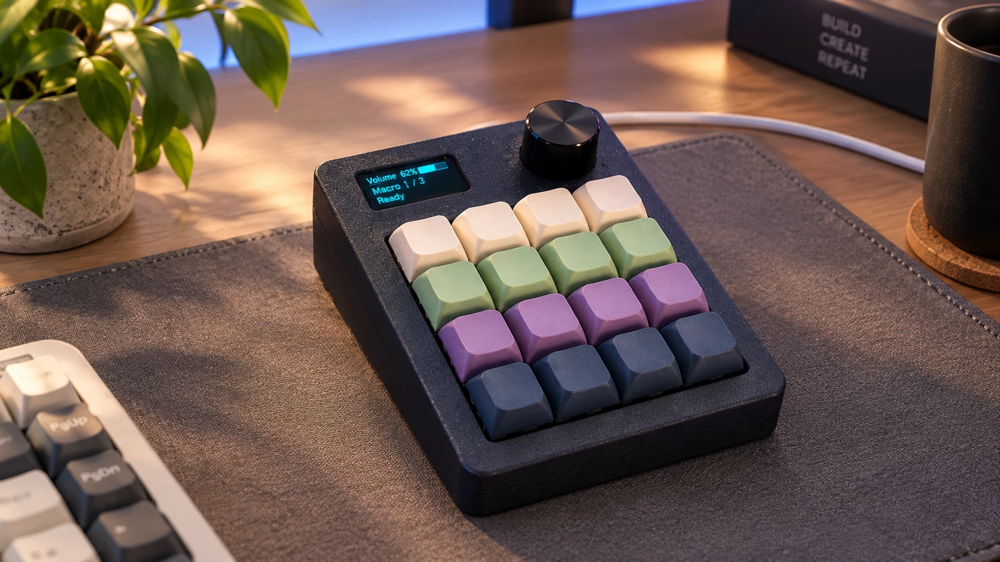
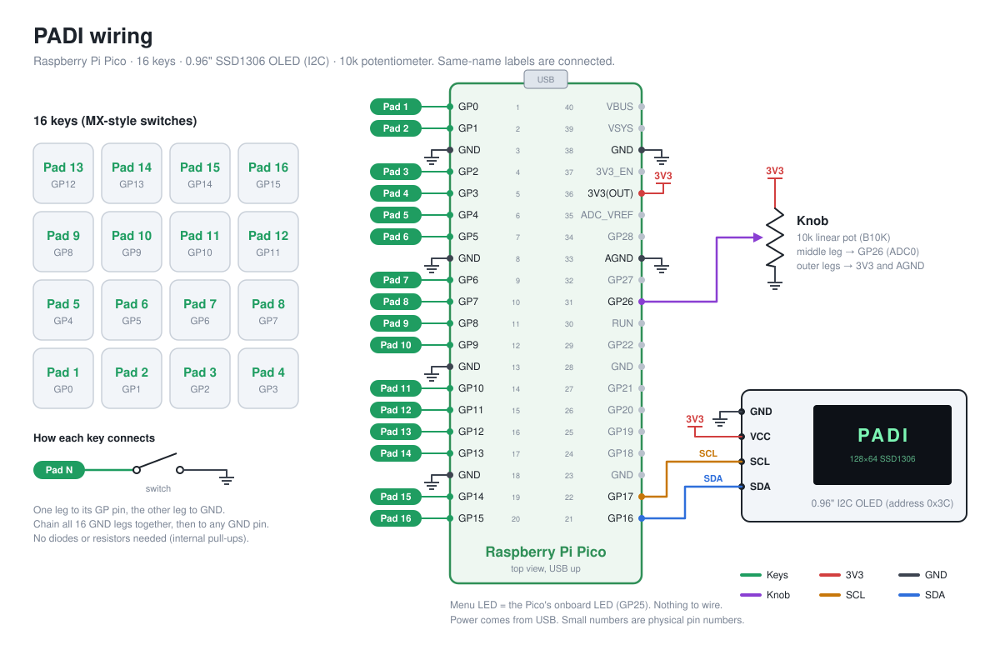

<div align="center">



# PADI

**A 16-key MIDI pad you build yourself, plus a desktop app that turns it into an instrument, sampler and looper.**

Raspberry Pi Pico · 0.96" OLED · one knob · 3D-printed case · Windows app (Tauri + Rust)

[**Download**](https://github.com/omer182/padi/releases/latest) · [Build it](#1-build-the-pad) · [Flash it](#2-flash-the-firmware) · [Install the app](#3-install-the-app) · [Play](#4-play)

</div>

---

## What it does

**On its own**, the pad is a plug-and-play USB MIDI controller. It works with GarageBand, Ableton, FL Studio, or any synth, with no drivers.

- Scales, chromatic, chords, strum and drum modes, picked from an on-screen menu
- Built-in drum grooves (RnB, Hip-hop, Trap, House…) to play along with
- The knob controls an effect: filter, reverb, chorus, pitch and more
- The OLED shows your sound, mode, the notes you're playing and the knob

**With the PADI app**, it also gets sounds and a studio:

- 🎹 **Hundreds of sounds** with nothing else to install: the full General MIDI set, plus real recorded guitars, a grand piano and weird sci-fi FX
- 🎛️ **Sound editor**: reverb, echo, chorus, brightness, octave and pan. Save tweaked sounds to *My sounds*; the stock ones never change.
- 🎤 **Record your voice onto a pad**: hold a pad, make a noise, let go. Turn it into a robot, chipmunk or monster, add echo, reverse it, or spread it across all 16 pads as a scale.
- 🔁 **Looper**: count-in, layer after layer, mute, solo, undo and redo
- 💾 **Save** your loops or the whole session as WAV files
- 👀 **Live view** of the pads, the knob and the notes as you play, with right-click menus on everything
- Runs in the tray and reconnects by itself when you plug the pad in

---

## 1. Build the pad

### Parts

| Qty | Part | Notes |
|---|---|---|
| 1 | Raspberry Pi Pico (RP2040) | Pico H (pre-soldered headers) is easiest |
| 16 | MX-style key switches | any MX-compatible switch (the plate has 14 mm holes) |
| 16 | 1u MX keycaps | |
| 1 | 0.96" SSD1306 OLED, 128×64, **I2C** | the 4-pin kind: GND, VCC, SCL, SDA |
| 1 | 10 kΩ linear potentiometer (B10K) + knob | |
| 4 | M3 × 12 mm screws + 4 M3 heat-set inserts | hold the case together |
| 4 | M2 self-tapping screws (short) | hold the Pico on its standoffs |
| 4 | rubber feet, Ø8 mm | they sit in recesses on the bottom |
| | hookup wire, soldering iron | |

### Print the case

The STL files are in [`hardware/case`](hardware/case):

| File | What it is |
|---|---|
| `Base_Shell.stl` | bottom shell with the Pico standoffs, screw tunnels and feet recesses |
| `Top_Shell.stl` | top shell with the screen window and knob hole |
| `Key_Plate.stl` | the plate the 16 switches clip into |

PLA or PETG, 0.2 mm layers and 15–20% infill all work. Print the shells flat side down. Press the heat-set inserts into the top shell while it's still on the bed or with a soldering iron.

### Wire it



| From | To Pico |
|---|---|
| Key 1 … Key 16 | GP0 … GP15 (key *N* goes to GP*N−1*), other leg to GND |
| OLED SDA / SCL | GP16 / GP17 |
| OLED VCC / GND | 3V3(OUT) (pin 36) / GND |
| Knob middle leg | GP26 (pin 31) |
| Knob outer legs | 3V3(OUT) and AGND (pin 33) |

- The keys need no diodes or resistors, because the Pico's internal pull-ups handle them.
- Chain the second leg of every switch together with one wire, then run it to any GND pin.
- The pad's LED is the Pico's own onboard LED, so there's nothing to wire for it.

The diagram is generated by [`hardware/make_wiring.py`](hardware/make_wiring.py).

### Assemble

1. Clip the 16 switches into the key plate and solder the wiring above.
2. Screw the Pico onto the standoffs in the base with the USB port facing the back opening.
3. Mount the OLED behind the screen window and the pot through the knob hole.
4. Drop the key plate into the top shell, close the case and screw it shut from the bottom (M3 × 12 into the inserts).
5. Stick the rubber feet into the four recesses.

---

## 2. Flash the firmware

No tools needed:

1. Download **`PADI-firmware.uf2`** from the [latest release](https://github.com/omer182/padi/releases/latest).
2. Hold the **BOOTSEL** button on the Pico and plug in the USB cable. A drive called **RPI-RP2** appears.
3. Drag `PADI-firmware.uf2` onto that drive. The Pico reboots, and the OLED plays the PADI intro.

That's it. Your computer now sees a MIDI device called **Macro MIDI Pad**.

> To update later, you don't need BOOTSEL: use *⋯ › Release pad port* in the app, then flash again (or use the command line below).

<details>
<summary>Build the firmware yourself (Arduino)</summary>

You need [arduino-cli](https://arduino.github.io/arduino-cli/) or Arduino IDE 2 with:

- the board package **Raspberry Pi Pico/RP2040** by Earle Philhower. Add `https://github.com/earlephilhower/arduino-pico/releases/download/global/package_rp2040_index.json` to the board manager URLs.
- the libraries **MIDI Library**, **Adafruit GFX**, **Adafruit SSD1306** and **Adafruit BusIO**.

```bash
arduino-cli compile -u -p COM3 --fqbn rp2040:rp2040:rpipico:usbstack=tinyusb firmware/macropad-midi
```

The `usbstack=tinyusb` option is required (it's what makes the Pico a USB MIDI device). In Arduino IDE, it's *Tools › USB Stack › Adafruit TinyUSB*. Replace `COM3` with your Pico's port.

</details>

---

## 3. Install the app

1. Download **`PADI_x64-setup.exe`** from the [latest release](https://github.com/omer182/padi/releases/latest) and run it.
2. Windows may show *"Windows protected your PC"* because the app isn't code-signed yet. Click **More info › Run anyway**.
3. Open **PADI** and plug in the pad. The three dots at the top turn green:
   - **Pad**: the MIDI link
   - **Live view**: the pad's state and presses
   - **Sound**: your speakers or headphones

PADI keeps running in the tray when you close the window. To start it with Windows, use *⋯ › Start with Windows*.

> **macOS / Linux:** the app is built with cross-platform parts (Tauri, cpal, midir), but only Windows has been tested so far. You can [build it from source](#build-the-app-from-source).

---

## 4. Play

### On the pad

| Do this | To |
|---|---|
| Press the **4 top keys together** | open or close the menu (the LED lights up) |
| In the menu: **key 13 / 14** | previous / next page |
| In the menu: **key 15 or 16** | exit |
| **Page 1, Instruments**: keys 1–8 pick, 9 / 10 switch category | choose a sound |
| **Page 2, Beats**: keys 1–8 | start a drum groove (*Off* stops it) |
| **Page 3, Scales**: keys 1–8, **9 = Drums**, **10 = Sampler** | choose how the keys play |
| **Page 4, Chords**: keys 1–8 | chord sets (bottom row plays chords, top plays melody) |
| **Page 5, Knob FX**: keys 1–8 | what the knob controls |

### In the app

- **Sounds tab:** click any sound to play it on the pads. **★ Extra sounds** shows the realistic guitars, piano and FX. Right-click a sound and pick *Preview* to hear it without changing the pads.
- **Sound editor** (right side): shape the sound, then **Save to My sounds**.
- **Record**: press **● Record**, hold any pad, make a noise, let go. The pad switches to *Sampler* mode and the take lands on that pad. Click a pad to edit it: play mode, Robot/Lo-fi voice, echo, pitch, Chipmunk/Monster, reverse, or Spread across all pads.
- **My kits:** your sampler kits and saved sounds. Right-click to rename, duplicate or delete.
- **Looper:** set BPM and bars, press **● Loop**. After one bar of clicks it records; press **Overdub** to add layers. Click a layer (L1, L2…) to mute it; right-click to solo or delete it.
- **Save:** *Save loop* writes one clean loop. *● Rec session* records everything you play. Files go to `Music\PADI`.
- **Undo / Redo:** the buttons above the pads, or **Ctrl+Z** / **Ctrl+Y**.

---

## Build the app from source

You need Node 20+, [Rust](https://rustup.rs) (stable) and, on Windows, the *Desktop development with C++* tools from Visual Studio.

```bash
cd desktop
npm install
bash scripts/get-packs.sh      # downloads the FreePats sound packs (about 145 MB), needs 7-Zip
npm run tauri dev              # run it
npm run tauri build            # make the installer (src-tauri/target/release/bundle/nsis)
```

The sound packs aren't in git (one is over 100 MB). Without them the app still works, with the General MIDI set only.

---

## How it fits together

```
 pad (Pico firmware)                         PADI app (Tauri)
 ─────────────────────                       ─────────────────────────────────────────────
 16 keys, knob, OLED  ──USB MIDI─────────▶  MIDI link ──▶ sound engine (Rust)
   modes, menus, beats                        │            SoundFont synths (rustysynth)
                      ──USB serial (COM)──▶  live view    sampler voices + echo + FX
                      ◀── "st 6" etc. ─────  mode sync    looper + recorder ──▶ speakers (cpal)
                                                          mic ──▶ pad recordings (WAV)
```

- **Firmware**: [`firmware/macropad-midi`](firmware/macropad-midi). Standard USB MIDI, so the pad works without the app too. A small serial protocol reports pad presses and state, and lets the app switch modes.
- **App**: [`desktop`](desktop). Rust backend: `engine.rs` (audio), `midi.rs`, `device.rs` (serial), `studio.rs` (kits, looper, recording). React UI in `desktop/src`.
- **Case and wiring**: [`hardware`](hardware).

## Troubleshooting

| Problem | Fix |
|---|---|
| **Pad** dot stays grey | Re-plug the USB cable. Check the firmware is flashed (the OLED shows the intro). |
| **Live view** grey, or the log says "device … not functioning" | Unplug and replug the pad. |
| No sound | Check the **Sound** dot and your Windows output device. PADI follows the default output. |
| A DAW can't see the pad while PADI is open | Windows lets only one app open a MIDI device. Quit PADI from the tray to use the pad in a DAW directly. |
| Recording hears nothing | Windows *Settings › Privacy › Microphone* must allow desktop apps. |
| Can't flash while PADI runs | *⋯ › Release pad port*, flash, then untick it. |
| Knob jumps around | It's a potentiometer, and cheap ones are noisy. The firmware filters and locks it at rest. A rotary encoder version is planned. |

## Credits

- Based on [**Macropad MIDI Controller**](https://github.com/NickCulbertson/Macropad-MIDI-Controller) by **Nick Culbertson** (MIT). The scales, chords and play modes started there.
- Case, wiring, OLED and knob features, and the PADI app by **[Omer Sher](https://omersher.com)**.
- Sounds: [**GeneralUser GS**](https://github.com/mrbumpy409/GeneralUser-GS) by S. Christian Collins, and packs from [**FreePats**](https://freepats.zenvoid.org) (guitars, piano, FX). Each pack's license and the attributions are in [`desktop/src-tauri/resources/packs/CREDITS.md`](desktop/src-tauri/resources/packs/CREDITS.md).

## License

MIT. See [LICENSE](LICENSE). Bundled sounds keep their own licenses (above).
